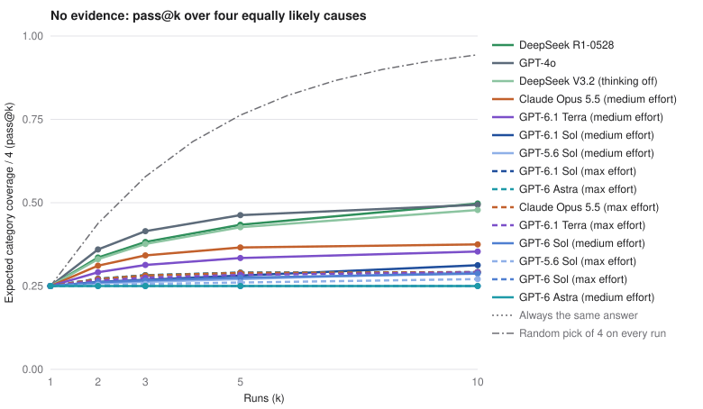

# Hypothesis Diversity Bench

When you run an analysis agent several times, do you get several analyses?

Teams scale agent analysis by running it again: parallel investigators, a
second opinion, self-consistency, best-of-k with a check. All of these assume
that independent runs explore different explanations. This benchmark measures
whether they do, on root-cause questions where an analyst would normally
consider several causes.

It is a companion to [Random Number Bench](https://github.com/bryantravissmith/random-number-bench),
which found that many current models answer "pick a random number from 1 to
10" with the same number almost every time, while older models such as GPT-4o
and DeepSeek V3.2 spread their answers. The spread is not simply old versus
new: GPT-6 Sol and GPT-6.1 Terra answer close to uniformly, while GPT-5.6 Sol
and GPT-6.1 Sol say 7 nearly every time. This benchmark asks whether that
collapse carries over to analysis, what it costs, and whether random-number
spread predicts hypothesis spread.

**[Results](RESULTS.md)** · [Findings](#findings) · [Design](#design) · [Run it](#run-a-round)

## Findings

First rounds, 2026-11-01: 13 conditions, 54 cases, 3,744 answers, all valid.
Brackets in [RESULTS.md](RESULTS.md) give 95% intervals over cases.



**1. Running a current model again mostly repeats its first answer.** With no
evidence, a model that always gives one answer finds the true cause 25% of
the time at any number of runs. After 10 runs:

| Condition | Effective causes per case | pass@1 | pass@10 |
| --- | ---: | ---: | ---: |
| DeepSeek R1-0528 | 1.77 | 0.25 | 0.50 |
| GPT-4o | 1.84 | 0.25 | 0.49 |
| DeepSeek V3.2, thinking off | 1.74 | 0.25 | 0.48 |
| Claude Opus 5.5, medium | 1.47 | 0.25 | 0.37 |
| GPT-6.1 Terra, medium | 1.35 | 0.25 | 0.35 |
| GPT-6.1 Sol, medium | 1.11 | 0.25 | 0.31 |
| Claude Opus 5.5, max | 1.16 | 0.25 | 0.29 |
| GPT-5.6 Sol, medium | 1.07 | 0.25 | 0.29 |
| GPT-6 Sol, max | 1.00 | 0.25 | 0.25 |

Every condition ties at one run. The older models double their chance by ten
runs; GPT-6 Sol at max effort gave the same cause in all 20 answers for every
case, so ten runs are worth exactly one.

**2. More effort means less exploration.** For every model run at both
settings, max effort lowered pass@10: Opus 0.37 to 0.29, GPT-6.1 Terra 0.35 to
0.29, GPT-6.1 Sol 0.31 to 0.29, GPT-5.6 Sol 0.29 to 0.27, GPT-6 Sol 0.29 to 0.25.

**3. Each vendor has a house story.** Across all six businesses, Opus blames
the tracking change (89 of 120 answers at medium, 112 at max). Every current
GPT model blames the release (79 to 100 of 120). GPT-4o and DeepSeek V3.2 are
the only conditions that regularly name the pricing or policy change (51 and
18 of 120), and the new traffic source is rare everywhere (at most 17 of 120,
for Opus at medium).

**4. Random-number spread does not predict hypothesis spread.** GPT-6 Sol and
GPT-6.1 Terra answer "random number from 1 to 10" almost uniformly in Random
Number Bench (about 9.4 to 9.8 effective answers at medium effort and above),
yet here they are among the most repetitive conditions. The older models that
spread here also spread numbers, so the number test can flag a collapsed
model but cannot certify a diverse one.

**5. When evidence narrows the field, current models still lean on their
default.** With two causes ruled out, current models almost never name an
excluded cause (0 to 6%), but at one run they land near a coin flip (0.46 to
0.58), and the GPT models score 0.83 when the release is the true cause versus
0.17 to 0.47 for policy. DeepSeek R1 does best (0.58 at one run, 0.75 at five).
GPT-4o and DeepSeek V3.2 name an excluded cause 19% and 38% of the time, so
their spread is partly noise.

**6. Every current model reads decisive evidence correctly.** When the
breakdowns identify the cause, all current conditions are right in every
answer; GPT-4o and DeepSeek V3.2 score 0.92 and 0.88.

**What it means for analysis agents.** Current models are better analysts per
answer and worse explorers across answers. On an underdetermined question,
parallel runs, second opinions and self-consistency votes from the same model
are not independent: they mostly restate the model's default story, and
higher effort makes that stronger. If coverage matters, ask for the
alternatives explicitly in one run, vary the model, or supply the
discriminating evidence, rather than relying on resampling.

## The question

Each case describes a metric that dropped and four changes that landed around
the same time, always one of each type:

| Cause type | Example (online store) |
| --- | --- |
| Release | A new site release to 90% of visitors, with a random 10% holdout |
| Traffic mix | A new paid social campaign |
| Tracking | A new tag manager configuration |
| Pricing or policy | Free shipping limited to orders of $50 or more |

The model names the single most likely cause and one check that would confirm
or rule it out. Every run is a fresh session with the same prompt.

## Design

Six scenarios (online store, SaaS, mobile app, food delivery, vacation rentals,
news subscriptions) appear in three evidence tiers.

- **None.** Only the headline drop and the change log. The true cause cannot be
  identified, so a model that always gives the same answer finds the true
  cause in 25% of cases however many times it runs. A model that spreads its
  answers finds it more often as runs are added. This is the coverage test.
- **Partial.** Diagnostic breakdowns rule out two causes and leave the true
  cause plus one alternative. This tests whether models use evidence, and
  whether repeated runs cover the two that remain.
- **Full.** Breakdowns for all four causes, where only the true cause shows its
  signature (for example, the order database holds steady while analytics
  orders fall). This is the control: it checks that every model can read the
  evidence.

True causes are balanced: every scenario appears with each of the four causes
in the partial and full tiers, so a model with a favorite story cannot win on
average. All numbers are generated from the true cause and are consistent with
it. Change-log and breakdown order are shuffled per case.

The headline metric is **pass@k**: the chance that at least one of k
independent runs names the true cause. With no evidence it averages over the
four equally likely causes. A collapsed model scores the same at k=1 and k=10.

### Grading

Each hypothesis is labeled with the change it names, using per-scenario
patterns. Answers that match no change or several go to a blinded review list
that shows only the scenario and the hypothesis text, never the model. Review
decisions and reasons are published with the results. Every planned trial
stays in the denominator: an invalid or missing answer is a miss.

### Conditions

| Condition | Runner | Round | Notes |
| --- | --- | --- | --- |
| Claude Opus 5.5, medium and max effort | Claude Code CLI | `round-001` | Subscription login, tools off, one turn |
| GPT-4o | Pi, OpenRouter | `round-001` | Provider default decoding, no reasoning |
| DeepSeek V3.2, thinking off | Pi, OpenRouter | `round-001` | Provider default decoding |
| DeepSeek R1-0528 | Pi, OpenRouter | `round-001` | Reasoning model |
| GPT-5.6 Sol, medium and max effort | Pi, ChatGPT subscription | `round-002` | OpenAI Responses through the `openai` provider |
| GPT-6 Sol, medium and max effort | Pi, ChatGPT subscription | `round-002` | Same |
| GPT-6.1 Sol, medium and max effort | Pi, ChatGPT subscription | `round-002` | Same |
| GPT-6.1 Terra, medium and max effort | Pi, ChatGPT subscription | `round-003` | Same |

All rounds use the same frozen seed, so their 54 case prompts are identical,
and they ran over overlapping periods. They are still separate runs and are
reported side by side, never pooled. The same system prompt (`You are a
helpful assistant.`) and working directory (`/`) are used for every
condition. Native CLIs add their own context, and OpenRouter routes to a
provider of its choosing, so treat the runner as part of each condition.
Model identity is checked against what each runner reports.

## Limits

- Six synthetic scenarios with a fixed structure. They are built so that the
  answer is knowable, not to match the messiness of real incidents.
- The none tier rewards spread by construction. Its point is to measure how
  much spread each model has, not to claim spread is always good: when the
  evidence identifies the cause, consistency is correct, which is what the
  full tier checks.
- Pattern labels can miss unusual phrasings. Every answer matching zero or
  several changes (353 of 3,744) was reviewed blind, and a blinded random
  sample of 60 pattern labels agreed in all 60
  ([spot check](results/label-spot-check.json)). The reviewer was Claude Code,
  the agent that built the benchmark; review decisions and reasons are
  published in each round's `reviews.json`.
- Opus and the current GPT models run through subscription logins whose
  decoding settings are not exposed, and no API lets callers set temperature
  for these reasoning models. GPT-4o and DeepSeek use OpenRouter defaults.
  Random Number Bench measured the GPT models through Codex; this benchmark
  calls them through Pi with the same subscription.
- The rounds ran on overlapping periods with identical cases but separate
  controllers, and are reported side by side, not pooled.

## Run a round

Requires Python 3.12+, [uv](https://docs.astral.sh/uv/), an authenticated
[Claude Code](https://code.claude.com) CLI for the Claude conditions and
[Pi](https://github.com/earendil-works/pi) logged in to OpenRouter and, for
the current GPT models, to the `openai` provider with a ChatGPT subscription.

```sh
# Freeze seed, cases, prompts, conditions and schedule. No inference.
# Reuse a seed (--seed) to run more conditions on identical cases.
uv run bench.py plan runs/round-003 --conditions opus-5.5-medium gpt-6.1-sol-medium

# Run with bounded concurrency per service. Ctrl-C pauses.
uv run bench.py run runs/round-003
uv run bench.py status runs/round-003

# Resume with the round's frozen source snapshot, which stays valid after
# the working copy changes.
uv run runs/round-003/source/bench.py run runs/round-003

# Verify raw evidence hashes and export explicit public fields.
uv run bench.py export runs/round-003 results/round-003

# Label, review the blinded list, then build the report from one or more
# rounds with identical cases.
uv run grade.py review results/round-003
uv run grade.py labels results/round-003
uv run analyze.py results/round-001 results/round-002 results/round-003 \
  --figures results/figures --report RESULTS.md
```

Preview any case prompt without calling a model:

```sh
uv run cases.py --seed preview --case ecommerce-checkout--partial--mix
```

## Test without calling a model

```sh
uv run tests/test_cases.py
uv run tests/test_pipeline.py
```

The tests check that cases are balanced and consistent with their true cause,
that only the true cause's breakdown shows its signature, answer parsing,
pass@k math, retries, resume, tamper detection and a full
plan-run-export-grade-report cycle against fake CLIs.

## License

MIT
