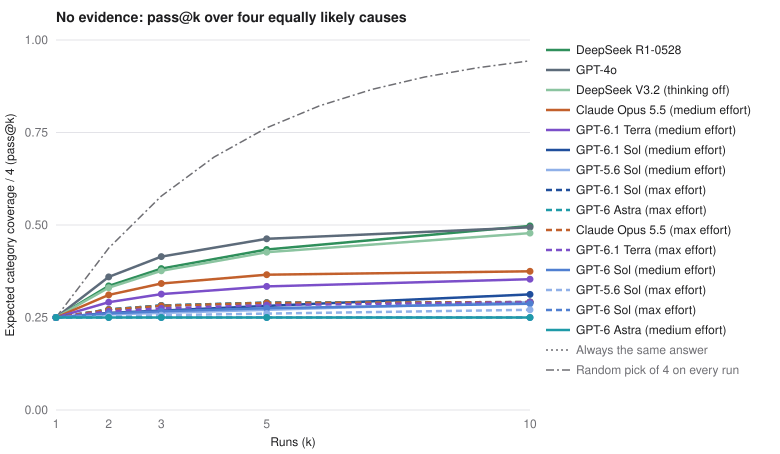
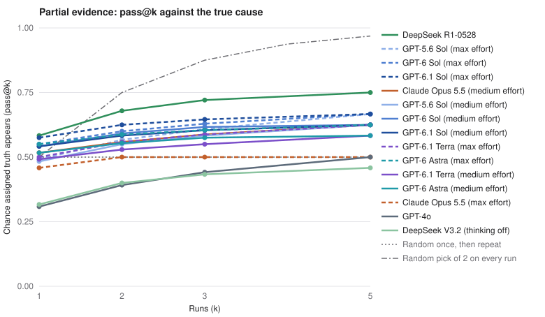

# Results

<!-- Generated by analyze.py. Do not edit by hand. -->

Rounds share one frozen seed and identical case prompts; they ran separately and are never pooled. The charts show plain-prompt conditions; meta-prompt conditions are compared in their own section. Every planned trial is in the denominator; trials without a valid answer count as misses. Brackets are 95% bootstrap intervals over cases.

| Round | Seed | State | Unfinished jobs | Trials per case | Label sources |
|---|---|---|---:|---|---|
| `round-001` | `84381f5ac1434825` | complete | 0 | none 20, partial 5, full 2 | pattern 1169, review 271 |
| `round-002` | `84381f5ac1434825` | complete | 0 | none 20, partial 5, full 2 | pattern 1667, review 61 |
| `round-003` | `84381f5ac1434825` | complete | 0 | none 20, partial 5, full 2 | pattern 555, review 21 |
| `round-004` | `84381f5ac1434825` | complete | 0 | none 20, partial 5, full 2 | pattern 2168, review 136 |

## No evidence: does running again explore other causes?

The true cause cannot be identified from the prompt. pass@k averages over the four equally likely true causes, so any single fixed answer scores 0.25 at every k, while picking one of the four uniformly at random on every run would score 1 - (3/4)^k (0.94 at k=10).

| Condition | Round | Effective causes | Modal share | pass@1 | pass@2 | pass@3 | pass@5 | pass@10 | Labels |
|---|---|---:|---:|---:|---:|---:|---:|---:|---|
| Claude Opus 5.5 (medium effort) | `round-001` | 1.47 | 0.81 | 0.25 [0.25, 0.25] | 0.31 [0.27, 0.36] | 0.34 [0.28, 0.41] | 0.37 [0.29, 0.45] | 0.37 [0.29, 0.46] | tracking 89, mix 17, release 14 |
| Claude Opus 5.5 (max effort) | `round-001` | 1.16 | 0.93 | 0.25 [0.25, 0.25] | 0.27 [0.25, 0.31] | 0.28 [0.25, 0.34] | 0.29 [0.25, 0.37] | 0.29 [0.25, 0.37] | tracking 112, release 8 |
| GPT-4o | `round-001` | 1.84 | 0.67 | 0.25 [0.25, 0.25] | 0.36 [0.34, 0.38] | 0.41 [0.38, 0.44] | 0.46 [0.43, 0.49] | 0.49 [0.48, 0.50] | release 60, policy 51, tracking 9 |
| DeepSeek V3.2 (thinking off) | `round-001` | 1.74 | 0.76 | 0.25 [0.25, 0.25] | 0.33 [0.28, 0.38] | 0.38 [0.30, 0.45] | 0.43 [0.33, 0.54] | 0.48 [0.35, 0.60] | release 90, policy 18, tracking 11, mix 1 |
| DeepSeek R1-0528 | `round-001` | 1.77 | 0.76 | 0.25 [0.25, 0.25] | 0.34 [0.29, 0.38] | 0.38 [0.31, 0.44] | 0.43 [0.34, 0.52] | 0.50 [0.37, 0.60] | release 87, tracking 29, mix 3, policy 1 |
| GPT-5.6 Sol (medium effort) | `round-002` | 1.07 | 0.98 | 0.25 [0.25, 0.25] | 0.26 [0.25, 0.27] | 0.26 [0.25, 0.27] | 0.27 [0.25, 0.29] | 0.29 [0.25, 0.33] | release 98, tracking 22 |
| GPT-5.6 Sol (max effort) | `round-002` | 1.04 | 0.99 | 0.25 [0.25, 0.25] | 0.25 [0.25, 0.26] | 0.26 [0.25, 0.27] | 0.26 [0.25, 0.28] | 0.27 [0.25, 0.31] | release 99, tracking 21 |
| GPT-6 Sol (medium effort) | `round-002` | 1.09 | 0.97 | 0.25 [0.25, 0.25] | 0.26 [0.25, 0.28] | 0.27 [0.25, 0.30] | 0.28 [0.25, 0.33] | 0.29 [0.25, 0.36] | release 97, tracking 20, policy 3 |
| GPT-6 Sol (max effort) | `round-002` | 1.00 | 1.00 | 0.25 [0.25, 0.25] | 0.25 [0.25, 0.25] | 0.25 [0.25, 0.25] | 0.25 [0.25, 0.25] | 0.25 [0.25, 0.25] | release 100, tracking 20 |
| GPT-6.1 Sol (medium effort) | `round-002` | 1.11 | 0.97 | 0.25 [0.25, 0.25] | 0.26 [0.25, 0.27] | 0.27 [0.26, 0.28] | 0.28 [0.26, 0.30] | 0.31 [0.27, 0.35] | release 79, tracking 41 |
| GPT-6.1 Sol (max effort) | `round-002` | 1.17 | 0.92 | 0.25 [0.25, 0.25] | 0.27 [0.25, 0.32] | 0.28 [0.25, 0.35] | 0.29 [0.25, 0.37] | 0.29 [0.25, 0.37] | release 89, tracking 31 |
| GPT-6.1 Terra (medium effort) | `round-003` | 1.35 | 0.88 | 0.25 [0.25, 0.25] | 0.29 [0.25, 0.33] | 0.31 [0.25, 0.38] | 0.33 [0.25, 0.43] | 0.35 [0.25, 0.48] | release 83, tracking 36, policy 1 |
| GPT-6.1 Terra (max effort) | `round-003` | 1.13 | 0.96 | 0.25 [0.25, 0.25] | 0.27 [0.25, 0.30] | 0.27 [0.25, 0.32] | 0.28 [0.25, 0.35] | 0.29 [0.25, 0.37] | release 95, tracking 25 |
| GPT-6 Astra (medium effort) | `round-004` | 1.00 | 1.00 | 0.25 [0.25, 0.25] | 0.25 [0.25, 0.25] | 0.25 [0.25, 0.25] | 0.25 [0.25, 0.25] | 0.25 [0.25, 0.25] | release 80, tracking 40 |
| GPT-6 Astra (max effort) | `round-004` | 1.17 | 0.92 | 0.25 [0.25, 0.25] | 0.27 [0.25, 0.32] | 0.28 [0.25, 0.35] | 0.29 [0.25, 0.37] | 0.29 [0.25, 0.37] | release 91, tracking 29 |
| GPT-6 Astra (medium effort, meta prompt) | `round-004` | 1.00 | 1.00 | 0.25 [0.25, 0.25] | 0.25 [0.25, 0.25] | 0.25 [0.25, 0.25] | 0.25 [0.25, 0.25] | 0.25 [0.25, 0.25] | release 80, tracking 40 |
| GPT-6 Astra (max effort, meta prompt) | `round-004` | 1.04 | 0.99 | 0.25 [0.25, 0.25] | 0.25 [0.25, 0.26] | 0.26 [0.25, 0.27] | 0.26 [0.25, 0.28] | 0.27 [0.25, 0.31] | release 81, tracking 39 |
| GPT-6.1 Sol (medium effort, meta prompt) | `round-004` | 1.00 | 1.00 | 0.25 [0.25, 0.25] | 0.25 [0.25, 0.25] | 0.25 [0.25, 0.25] | 0.25 [0.25, 0.25] | 0.25 [0.25, 0.25] | release 80, tracking 40 |
| GPT-6.1 Sol (max effort, meta prompt) | `round-004` | 1.06 | 0.98 | 0.25 [0.25, 0.25] | 0.26 [0.25, 0.27] | 0.26 [0.25, 0.29] | 0.27 [0.25, 0.31] | 0.28 [0.25, 0.35] | release 82, tracking 38 |
| GPT-6.1 Terra (medium effort, meta prompt) | `round-004` | 1.20 | 0.92 | 0.25 [0.25, 0.25] | 0.28 [0.25, 0.32] | 0.29 [0.25, 0.35] | 0.30 [0.25, 0.38] | 0.31 [0.25, 0.40] | release 88, tracking 31, mix 1 |
| GPT-6.1 Terra (max effort, meta prompt) | `round-004` | 1.14 | 0.95 | 0.25 [0.25, 0.25] | 0.27 [0.25, 0.31] | 0.28 [0.25, 0.33] | 0.29 [0.25, 0.36] | 0.29 [0.25, 0.37] | release 94, tracking 26 |

## Partial evidence: two causes ruled out

Diagnostics rule out two causes and leave the true cause and one alternative. Always giving the same one of the two scores 0.50 at every k; picking between them uniformly at random on every run scores 1 - (1/2)^k. Ruled-out rate is the share of answers naming a cause the evidence excluded.

| Condition | Round | pass@1 | pass@2 | pass@3 | pass@5 | Ruled-out rate | Accuracy by true cause (pass@1) |
|---|---|---:|---:|---:|---:|---:|---|
| Claude Opus 5.5 (medium effort) | `round-001` | 0.52 [0.34, 0.68] | 0.56 [0.38, 0.74] | 0.59 [0.40, 0.77] | 0.62 [0.42, 0.83] | 0.00 | mix 0.47, policy 0.23, release 0.70, tracking 0.67 |
| Claude Opus 5.5 (max effort) | `round-001` | 0.46 [0.27, 0.64] | 0.50 [0.29, 0.71] | 0.50 [0.29, 0.71] | 0.50 [0.29, 0.71] | 0.06 | mix 0.17, policy 0.43, release 0.63, tracking 0.60 |
| GPT-4o | `round-001` | 0.31 [0.17, 0.47] | 0.39 [0.23, 0.56] | 0.44 [0.25, 0.63] | 0.50 [0.29, 0.71] | 0.19 | mix 0.03, policy 0.53, release 0.50, tracking 0.17 |
| DeepSeek V3.2 (thinking off) | `round-001` | 0.32 [0.17, 0.48] | 0.40 [0.23, 0.59] | 0.43 [0.25, 0.62] | 0.46 [0.25, 0.67] | 0.38 | mix 0.17, policy 0.23, release 0.63, tracking 0.23 |
| DeepSeek R1-0528 | `round-001` | 0.58 [0.42, 0.74] | 0.68 [0.52, 0.84] | 0.72 [0.54, 0.88] | 0.75 [0.58, 0.92] | 0.04 | mix 0.43, policy 0.30, release 0.93, tracking 0.67 |
| GPT-5.6 Sol (medium effort) | `round-002` | 0.48 [0.30, 0.65] | 0.55 [0.38, 0.73] | 0.58 [0.40, 0.76] | 0.62 [0.42, 0.79] | 0.00 | mix 0.23, policy 0.33, release 0.83, tracking 0.53 |
| GPT-5.6 Sol (max effort) | `round-002` | 0.49 [0.32, 0.67] | 0.57 [0.39, 0.73] | 0.61 [0.42, 0.78] | 0.67 [0.46, 0.83] | 0.00 | mix 0.30, policy 0.23, release 0.83, tracking 0.60 |
| GPT-6 Sol (medium effort) | `round-002` | 0.54 [0.35, 0.72] | 0.59 [0.39, 0.77] | 0.62 [0.42, 0.79] | 0.62 [0.42, 0.83] | 0.01 | mix 0.40, policy 0.40, release 0.83, tracking 0.53 |
| GPT-6 Sol (max effort) | `round-002` | 0.55 [0.38, 0.73] | 0.60 [0.42, 0.78] | 0.63 [0.44, 0.81] | 0.67 [0.46, 0.83] | 0.02 | mix 0.33, policy 0.47, release 0.83, tracking 0.57 |
| GPT-6.1 Sol (medium effort) | `round-002` | 0.54 [0.35, 0.72] | 0.58 [0.39, 0.77] | 0.60 [0.41, 0.79] | 0.62 [0.42, 0.79] | 0.00 | mix 0.33, policy 0.23, release 0.83, tracking 0.77 |
| GPT-6.1 Sol (max effort) | `round-002` | 0.58 [0.38, 0.76] | 0.62 [0.44, 0.81] | 0.65 [0.46, 0.83] | 0.67 [0.50, 0.83] | 0.01 | mix 0.33, policy 0.30, release 0.83, tracking 0.83 |
| GPT-6.1 Terra (medium effort) | `round-003` | 0.49 [0.30, 0.67] | 0.53 [0.35, 0.71] | 0.55 [0.35, 0.74] | 0.58 [0.38, 0.79] | 0.00 | mix 0.33, policy 0.17, release 0.83, tracking 0.63 |
| GPT-6.1 Terra (max effort) | `round-003` | 0.50 [0.32, 0.67] | 0.56 [0.38, 0.74] | 0.59 [0.40, 0.76] | 0.62 [0.42, 0.83] | 0.00 | mix 0.20, policy 0.33, release 0.83, tracking 0.63 |
| GPT-6 Astra (medium effort) | `round-004` | 0.52 [0.33, 0.69] | 0.55 [0.37, 0.74] | 0.58 [0.38, 0.75] | 0.58 [0.38, 0.79] | 0.02 | mix 0.33, policy 0.23, release 0.83, tracking 0.67 |
| GPT-6 Astra (max effort) | `round-004` | 0.55 [0.36, 0.73] | 0.59 [0.39, 0.78] | 0.60 [0.42, 0.78] | 0.62 [0.42, 0.83] | 0.02 | mix 0.30, policy 0.27, release 0.83, tracking 0.80 |
| GPT-6 Astra (medium effort, meta prompt) | `round-004` | 0.52 [0.33, 0.71] | 0.56 [0.35, 0.74] | 0.58 [0.37, 0.78] | 0.58 [0.38, 0.79] | 0.02 | mix 0.30, policy 0.37, release 0.83, tracking 0.57 |
| GPT-6 Astra (max effort, meta prompt) | `round-004` | 0.53 [0.33, 0.71] | 0.56 [0.38, 0.74] | 0.58 [0.38, 0.77] | 0.58 [0.38, 0.79] | 0.00 | mix 0.13, policy 0.47, release 0.83, tracking 0.67 |
| GPT-6.1 Sol (medium effort, meta prompt) | `round-004` | 0.54 [0.35, 0.72] | 0.58 [0.38, 0.77] | 0.60 [0.41, 0.79] | 0.62 [0.42, 0.79] | 0.01 | mix 0.33, policy 0.27, release 0.83, tracking 0.73 |
| GPT-6.1 Sol (max effort, meta prompt) | `round-004` | 0.58 [0.39, 0.75] | 0.62 [0.41, 0.82] | 0.62 [0.42, 0.83] | 0.62 [0.46, 0.79] | 0.02 | mix 0.23, policy 0.40, release 0.83, tracking 0.83 |
| GPT-6.1 Terra (medium effort, meta prompt) | `round-004` | 0.55 [0.37, 0.73] | 0.60 [0.42, 0.78] | 0.63 [0.44, 0.82] | 0.67 [0.46, 0.83] | 0.00 | mix 0.40, policy 0.23, release 0.83, tracking 0.73 |
| GPT-6.1 Terra (max effort, meta prompt) | `round-004` | 0.52 [0.34, 0.69] | 0.59 [0.41, 0.75] | 0.62 [0.44, 0.80] | 0.67 [0.50, 0.83] | 0.01 | mix 0.10, policy 0.40, release 0.83, tracking 0.73 |

## Full evidence: the cause is identifiable

Diagnostics for all four causes are shown and only the true cause shows its signature. This is the control: it checks that models read the evidence.

| Condition | Round | pass@1 | pass@2 | Ruled-out rate | Accuracy by true cause (pass@1) |
|---|---|---:|---:|---:|---|
| Claude Opus 5.5 (medium effort) | `round-001` | 1.00 [1.00, 1.00] | 1.00 [1.00, 1.00] | 0.00 | mix 1.00, policy 1.00, release 1.00, tracking 1.00 |
| Claude Opus 5.5 (max effort) | `round-001` | 1.00 [1.00, 1.00] | 1.00 [1.00, 1.00] | 0.00 | mix 1.00, policy 1.00, release 1.00, tracking 1.00 |
| GPT-4o | `round-001` | 0.92 [0.81, 1.00] | 0.96 [0.88, 1.00] | 0.08 | mix 0.92, policy 1.00, release 0.83, tracking 0.92 |
| DeepSeek V3.2 (thinking off) | `round-001` | 0.88 [0.75, 0.98] | 0.92 [0.79, 1.00] | 0.12 | mix 0.75, policy 0.83, release 0.92, tracking 1.00 |
| DeepSeek R1-0528 | `round-001` | 1.00 [1.00, 1.00] | 1.00 [1.00, 1.00] | 0.00 | mix 1.00, policy 1.00, release 1.00, tracking 1.00 |
| GPT-5.6 Sol (medium effort) | `round-002` | 1.00 [1.00, 1.00] | 1.00 [1.00, 1.00] | 0.00 | mix 1.00, policy 1.00, release 1.00, tracking 1.00 |
| GPT-5.6 Sol (max effort) | `round-002` | 1.00 [1.00, 1.00] | 1.00 [1.00, 1.00] | 0.00 | mix 1.00, policy 1.00, release 1.00, tracking 1.00 |
| GPT-6 Sol (medium effort) | `round-002` | 1.00 [1.00, 1.00] | 1.00 [1.00, 1.00] | 0.00 | mix 1.00, policy 1.00, release 1.00, tracking 1.00 |
| GPT-6 Sol (max effort) | `round-002` | 1.00 [1.00, 1.00] | 1.00 [1.00, 1.00] | 0.00 | mix 1.00, policy 1.00, release 1.00, tracking 1.00 |
| GPT-6.1 Sol (medium effort) | `round-002` | 1.00 [1.00, 1.00] | 1.00 [1.00, 1.00] | 0.00 | mix 1.00, policy 1.00, release 1.00, tracking 1.00 |
| GPT-6.1 Sol (max effort) | `round-002` | 1.00 [1.00, 1.00] | 1.00 [1.00, 1.00] | 0.00 | mix 1.00, policy 1.00, release 1.00, tracking 1.00 |
| GPT-6.1 Terra (medium effort) | `round-003` | 1.00 [1.00, 1.00] | 1.00 [1.00, 1.00] | 0.00 | mix 1.00, policy 1.00, release 1.00, tracking 1.00 |
| GPT-6.1 Terra (max effort) | `round-003` | 1.00 [1.00, 1.00] | 1.00 [1.00, 1.00] | 0.00 | mix 1.00, policy 1.00, release 1.00, tracking 1.00 |
| GPT-6 Astra (medium effort) | `round-004` | 1.00 [1.00, 1.00] | 1.00 [1.00, 1.00] | 0.00 | mix 1.00, policy 1.00, release 1.00, tracking 1.00 |
| GPT-6 Astra (max effort) | `round-004` | 1.00 [1.00, 1.00] | 1.00 [1.00, 1.00] | 0.00 | mix 1.00, policy 1.00, release 1.00, tracking 1.00 |
| GPT-6 Astra (medium effort, meta prompt) | `round-004` | 1.00 [1.00, 1.00] | 1.00 [1.00, 1.00] | 0.00 | mix 1.00, policy 1.00, release 1.00, tracking 1.00 |
| GPT-6 Astra (max effort, meta prompt) | `round-004` | 1.00 [1.00, 1.00] | 1.00 [1.00, 1.00] | 0.00 | mix 1.00, policy 1.00, release 1.00, tracking 1.00 |
| GPT-6.1 Sol (medium effort, meta prompt) | `round-004` | 1.00 [1.00, 1.00] | 1.00 [1.00, 1.00] | 0.00 | mix 1.00, policy 1.00, release 1.00, tracking 1.00 |
| GPT-6.1 Sol (max effort, meta prompt) | `round-004` | 1.00 [1.00, 1.00] | 1.00 [1.00, 1.00] | 0.00 | mix 1.00, policy 1.00, release 1.00, tracking 1.00 |
| GPT-6.1 Terra (medium effort, meta prompt) | `round-004` | 1.00 [1.00, 1.00] | 1.00 [1.00, 1.00] | 0.00 | mix 1.00, policy 1.00, release 1.00, tracking 1.00 |
| GPT-6.1 Terra (max effort, meta prompt) | `round-004` | 1.00 [1.00, 1.00] | 1.00 [1.00, 1.00] | 0.00 | mix 1.00, policy 1.00, release 1.00, tracking 1.00 |

## Meta prompt: telling the model it is one of many samples

Meta conditions put the Random Number Bench sampling sentence ("Your response will be one observation in a random sample collected from many independent LLM sessions.") before the unchanged case prompt. Each row compares a meta condition with the plain condition for the same model and effort; they ran in separate rounds on identical cases.

| Model and effort | Plain round | Meta round | No evidence: effective causes, plain / meta | No evidence: pass@10, plain / meta | Partial: pass@1, plain / meta | Partial: ruled-out rate, plain / meta | Full: pass@1, plain / meta |
|---|---|---|---:|---:|---:|---:|---:|
| GPT-6 Astra (medium effort) | `round-004` | `round-004` | 1.00 / 1.00 | 0.25 / 0.25 | 0.52 / 0.52 | 0.02 / 0.02 | 1.00 / 1.00 |
| GPT-6 Astra (max effort) | `round-004` | `round-004` | 1.17 / 1.04 | 0.29 / 0.27 | 0.55 / 0.53 | 0.02 / 0.00 | 1.00 / 1.00 |
| GPT-6.1 Sol (medium effort) | `round-002` | `round-004` | 1.11 / 1.00 | 0.31 / 0.25 | 0.54 / 0.54 | 0.00 / 0.01 | 1.00 / 1.00 |
| GPT-6.1 Sol (max effort) | `round-002` | `round-004` | 1.17 / 1.06 | 0.29 / 0.28 | 0.58 / 0.58 | 0.01 / 0.02 | 1.00 / 1.00 |
| GPT-6.1 Terra (medium effort) | `round-003` | `round-004` | 1.35 / 1.20 | 0.35 / 0.31 | 0.49 / 0.55 | 0.00 / 0.00 | 1.00 / 1.00 |
| GPT-6.1 Terra (max effort) | `round-003` | `round-004` | 1.13 / 1.14 | 0.29 / 0.29 | 0.50 / 0.52 | 0.00 / 0.01 | 1.00 / 1.00 |

## Labels

Pattern labels come from each scenario's change patterns. Review labels were assigned from a blinded list that shows only the scenario and hypothesis text, never the model; decisions and reasons are in each round's `reviews.json`.
