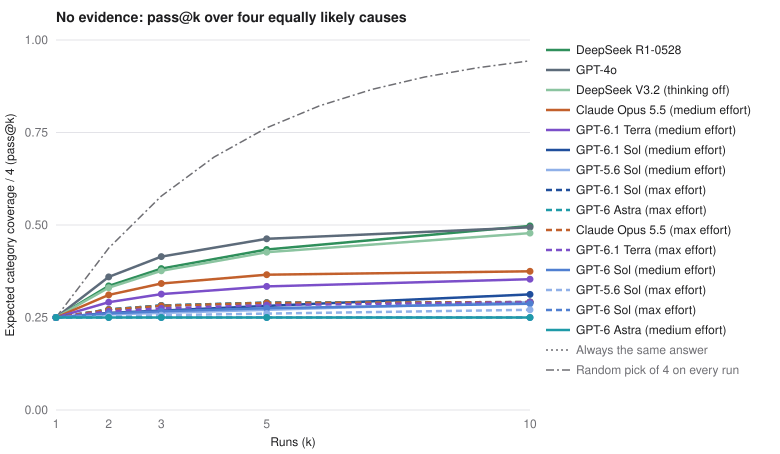

# Results and interpretation

The benchmark measures cause-category coverage across repeated answers to
six synthetic business scenarios. Rounds 001-004 contain 21 conditions and
6,048 final answers. [Full tables](RESULTS.md) report estimates and 95%
confidence intervals; [method details](docs/INTERVALS.md) describe the scoring
and uncertainty calculations.

## Findings

Responses showed high concentration when evidence was absent. GPT conditions
with medium/max effort and Opus reached no-evidence pass@10 scores of
0.25-0.37. GPT-4o and the two DeepSeek conditions reached approximately
0.48-0.50. With full diagnostic evidence, every GPT condition with medium/max
effort, Opus and DeepSeek R1 answered all 48 trials correctly.

## No evidence: high concentration

GPT-6 Sol at max effort selected the same category in all 20 trials for each
of the six prompts: release in five scenarios and tracking in the mobile
retention scenario. Its pass@10 equals pass@1 at 0.25. GPT-6 Astra at medium
effort also selected one category per prompt in all 20 trials.

The score averages over four hypothetical equally likely truths. A fixed
category scores 0.25 at every k. Independent uniform choices across the four
causes reach 0.9437 at k=10. Both reference strategies appear in the figure.

### Effort and cause preferences

Max effort has a lower no-evidence pass@10 estimate in five of six
plain-prompt comparisons. Astra rises from 0.250 to 0.292. All six
family-adjusted difference intervals include zero.

GPT-6.1 Sol's effective-cause count rises from 1.11 at medium effort to 1.17
at max. Its pass@2 increases and its pass@10 decreases. Effective causes is
the exponential of observed label entropy, averaged over cases.

Opus selects tracking in 89/120 no-evidence answers at medium and 112/120 at
max. GPT conditions with medium/max effort select release in 79-100/120.

## Partial evidence

GPT conditions with medium/max effort and Opus select excluded causes in
approximately 0-6% of answers. GPT-4o and DeepSeek V3.2 do so in approximately
19% and 38%. DeepSeek R1 has the highest partial-evidence pass@5, at 0.75.

Assigned truths are balanced overall. The remaining pairs have the following
distribution:

| Remaining pair | Assigned truths | Total cases |
| --- | --- | ---: |
| Release / mix | Release 2, mix 1 | 3 |
| Release / tracking | Release 1, tracking 1 | 2 |
| Release / policy | Release 3, policy 2 | 5 |
| Mix / tracking | Mix 2, tracking 0 | 2 |
| Mix / policy | Mix 3, policy 2 | 5 |
| Tracking / policy | Tracking 5, policy 2 | 7 |

A fixed preference for release, then mix, tracking and policy scores 16/24
(66.7%) on these cases. This post hoc calculation describes the effect of
pair imbalance on the benchmark.

### Reference curves

Choosing once uniformly between the two remaining causes and repeating that
choice has expected score 0.50 at every k. Choosing independently on every
run produces `1 - (1/2)^k`.

| k | Four causes: `1 - (3/4)^k` | Two remaining causes: `1 - (1/2)^k` |
| ---: | ---: | ---: |
| 1 | 0.2500 | 0.5000 |
| 2 | 0.4375 | 0.7500 |
| 3 | 0.5781 | 0.8750 |
| 5 | 0.7627 | 0.9688 |
| 10 | 0.9437 | n/a: 5 trials per partial case |

The [partial-evidence chart](results/figures/passk-partial.svg) includes the
fixed-choice and independent-choice references.

## Sampling-context prompt

Six conditions prepend: "Your response will be one observation in a random
sample collected from many independent LLM sessions." Each retains the base
prompt's request for the single most likely cause.

| Model and effort | Plain pass@10 | Meta pass@10 | Meta minus plain |
| --- | ---: | ---: | ---: |
| GPT-6 Astra, medium | 0.2500 | 0.2500 | 0.0000 |
| GPT-6 Astra, max | 0.2917 | 0.2708 | -0.0208 |
| GPT-6.1 Sol, medium | 0.3125 | 0.2500 | -0.0625 |
| GPT-6.1 Sol, max | 0.2917 | 0.2818 | -0.0099 |
| GPT-6.1 Terra, medium | 0.3535 | 0.3125 | -0.0410 |
| GPT-6.1 Terra, max | 0.2910 | 0.2914 | +0.0005 |

Differences use unrounded estimates. All six family-adjusted confidence
intervals include zero. Astra pairs were collected within round 004;
Sol/Terra pairs cross rounds. Full-evidence accuracy is 48/48 for every
sampling-prefix condition.

## Full evidence

Every GPT condition with medium/max effort, Opus and DeepSeek R1 has 48/48
correct answers across 24 cases. GPT-4o has 44/48 and DeepSeek V3.2 has 42/48.
A 48/48 result has a pointwise pass@1 95% CI of [0.926, 1.000] and a pass@2
95% CI of [0.858, 1.000].

## Confidence intervals and scenario sensitivity

[Confidence intervals and direct comparisons](results/figures/UNCERTAINTY.md)
use conservative bounds for repeated calls to the fixed prompts. GPT-6 Sol
max's no-evidence pass@10 is 0.250 with a 95% CI of [0.034, 0.635].

The two comparison families are max-minus-medium and sampling-prefix-minus-plain,
each with six contrasts and a separate 5% error budget. The report also gives
six individual scenario effects, leave-one-scenario-out estimates and paired
scenario-bootstrap percentiles. These sensitivity summaries use all 46,656
ordered resamples of the six templates.

The [validation report](results/validation/VALIDATION.md) evaluates 10,000
synthetic datasets per setting. Coverage ranges from 99.36% to 100% in the
15 independent, stationary settings. Both six-contrast families have 100%
simulated simultaneous coverage. Dependence and drift stress tests have 0%
coverage. The [methods](docs/INTERVALS.md) specify the assumptions and scope.

## Dataset and scoring

All rounds use seed `84381f5ac1434825` and identical base case records.
Collection occurred on November 1-2, 2026 in America/Los_Angeles, all on
November 2 in exported UTC timestamps. Rounds 001-003 overlap; round 004
ran later.

| Round | Conditions | Planned trials / valid final answers | Physical attempts | Operational failures |
| --- | ---: | ---: | ---: | --- |
| round-001 | 5 | 1,440 | 1,443 | 3 timeouts |
| round-002 | 6 | 1,728 | 1,733 | 5 errors |
| round-003 | 2 | 576 | 576 | 0 |
| round-004 | 8 | 2,304 | 2,308 | 4 errors |
| Total | 21 | 6,048 | 6,060 | 12 |

Each condition has 20 trials on each of six no-evidence prompts, five trials
on each of 24 partial-evidence cases, and two trials on each of 24 full-evidence
cases. Scoring uses the hypothesis's cause category. Each planned job's final
attempt is scored; invalid and missing answers count as misses.

All final answers contain a nonempty hypothesis and check. Of the 6,048 valid
answers, 623 have surrounding text or formatting. The parser accepts an
extractable JSON object; check quality is ungraded.

There are 5,559 pattern labels and 489 review labels. The benchmark-building
Claude Code agent reviewed ambiguous answers and a 60-answer pattern-label
sample from rounds 001-003, with 60 agreements. Round 004 contributes 136
review labels. The saved [spot check](results/label-spot-check.json) covers
rounds 001-003.

Claude conditions use Claude Code; GPT conditions with medium/max effort
use Pi with a ChatGPT subscription; GPT-4o and DeepSeek use Pi/OpenRouter.
Change order is fixed within a case. Dates are tied to cause type: mix starts
October 12, release/tracking October 13, and policy October 14.

## Companion benchmark

The Random Number Bench
[Codex grid](https://github.com/bryantravissmith/random-number-bench/blob/main/results/2026-11-01-grid-codex-001/summary.json)
reports 8.81-9.81 effective numbers for GPT-6 Sol and GPT-6.1 Terra at medium
effort and above. Those models show concentrated cause choices here. The
GPT runner is Codex in that benchmark and Pi in this one.

## Further work

- Audit a blinded sample of automatic and adjudicated labels from every round
  with independent reviewers and a recorded sampling plan.
- Add distinct scenarios and balance every partial-evidence truth/alternative
  pair, with matched wording, dates and diagnostic evidence.
- Collect more repetitions for tighter fixed-prompt confidence intervals.
- Compare ranked alternatives, explicit sampling, investigative perspectives
  and mixed-model sets at comparable token and latency budgets.
- Score proposed checks, executed investigations and verified final diagnoses.
